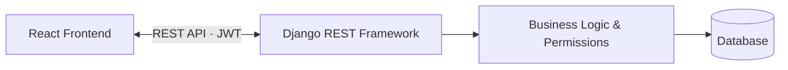

# 🚀 NerveCMS

**NerveCMS** is a full-stack business management and customer relationship platform built with **Django REST Framework** and **React**. It brings customer management, sales, inventory, tasks, and financial records together in one application.

## ✨ Key Features

- 👥 **Customer Management** — customer profiles, notes, statuses, and assignments.
- 🛒 **Sales & Purchasing** — orders, suppliers, purchases, and returns.
- 📦 **Inventory Management** — products, warehouses, stock levels, and transfers.
- 💰 **Financial Management** — invoices, payments, expenses, and reports.
- ✅ **Tasks & Teams** — task assignments, priorities, deadlines, and role-based access.
- 📊 **Business Dashboard** — key metrics, revenue trends, and low-stock alerts.
- 🏢 **Multi-Tenant Architecture** — business data separation and role-aware permissions.

## 🧰 Tech Stack

| Backend | Frontend | Database & API |
|---|---|---|
| Python · Django 5 | React 19 · Vite | SQLite (Development) |
| Django REST Framework | React Router | PostgreSQL (Production) |
| Simple JWT | Axios | REST API · JSON |
| drf-spectacular | Tailwind CSS 4 | OpenAPI / Swagger UI |

## 🏗️ Architecture

The application uses a separated frontend and backend architecture. React communicates with the Django REST API over HTTP, while the backend handles business logic, authentication, permissions, and database operations.



### 📁 Project Structure

```text
nexus-crm/
├── backend/
│   ├── accounts/     # Authentication and user roles
│   ├── customers/    # Customer management
│   ├── inventory/    # Products, stock, and warehouses
│   ├── sales/        # Orders and returns
│   ├── tasks/        # Task management
│   ├── finance/      # Invoices, payments, and expenses
│   ├── dashboard/   # Dashboard data
│   └── crm_project/  # Django configuration
└── frontend/
    └── src/
        ├── api/         # API client
        ├── components/  # Reusable UI components
        ├── context/     # Authentication state
        └── pages/       # Application screens
```

## 🔐 Authentication & API

The backend uses JWT authentication and role-aware permissions.

Key API endpoints:

- `POST /api/auth/signup/` — Business registration
- `POST /api/auth/login/` — Authentication
- `/api/customers/` — Customer management
- `/api/products/` — Product management
- `/api/orders/` — Sales orders
- `/api/dashboard/summary/` — Dashboard metrics
- `/api/schema/swagger-ui/` — Interactive API documentation

## ⚙️ Getting Started

**Requirements:** Python, Node.js, and npm.

### Backend

```bash
cd backend
python -m venv .venv
pip install -r requirements.txt
python manage.py migrate
python manage.py runserver
```

### Frontend

Open a separate terminal:

```bash
cd frontend
npm install
npm run dev
```

Configure the API URL in `frontend/.env` if needed:

```dotenv
VITE_API_URL=http://127.0.0.1:8000/api
```

## 🚢 Deployment

Deployment configurations are included for **Render** (backend) and **Vercel** (frontend).

## 👨‍💻 Project Highlights

This project demonstrates full-stack development, REST API design, JWT authentication, role-based access control, multi-tenant architecture, and modern frontend development.

---

**Built with ❤️ using Django REST Framework and React.**
